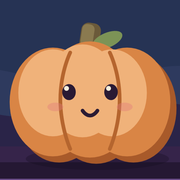
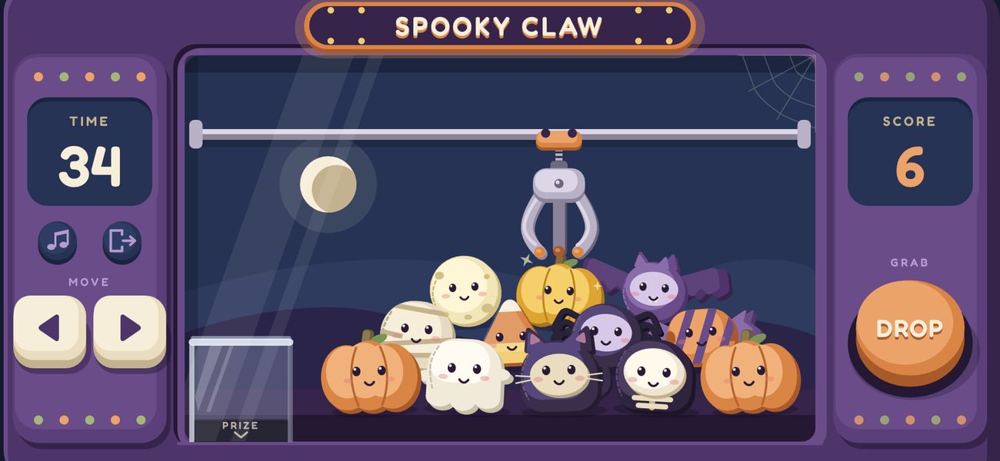

  

<h1 align="center">Spooky Claw</h1>

  A Halloween claw machine game for your browser. 
  <strong><a href="https://heydaveperkins.github.io/spooky-claw/">Play it here</a></strong>

Grab as many plushies as you can in **60 seconds** and drop them into the prize
chute. Ghosts, black cats, pumpkins, bats, skeletons, mummies, spiders, candy
corn, full moons and wrapped candy are all waiting in the machine, along with a
rare golden pumpkin.

Clear out all 12 before the timer runs out and you'll be in for a monster of a
surprise.

---

## Best on your phone's home screen

The game plays in any browser. On a phone, it plays best **added to your home
screen**:

- It opens **full screen**, with no browser bars taking up space.
- The cabinet and controls are **bigger** and easier to tap.
- There's no accidental scrolling, zooming or swiping back mid-game.
- It gets its own **pumpkin icon**, so it's one tap to play.

### iPhone and iPad

1. Open **[heydaveperkins.github.io/spooky-claw](https://heydaveperkins.github.io/spooky-claw/)**
   in **Safari**.
2. Tap the **Share** button: the square with an arrow pointing up out of it.
   - On iPhone it's in the toolbar at the bottom of the screen, or at the top
     when the phone is sideways.
   - If you don't see the toolbar, tap the address bar or scroll up slightly.
   - On iPad it's at the top right.
3. Scroll down the share sheet and tap **Add to Home Screen**.
   - Don't see it? Scroll to the bottom and tap **Edit Actions...** to add it.
4. Leave the name as **Spooky Claw** and tap **Add**.
5. Go to your home screen and tap the **Spooky Claw** pumpkin icon.
6. Turn your phone **sideways** (landscape) and tap **TAP TO ENTER**.

> **Using Chrome or another browser on iPhone?** On iOS 16.4 and later, you can
> also add to the home screen from those browsers' share menus. On older
> versions, open the link in Safari to add it.

**To remove it later**, press and hold the pumpkin icon on your home screen and
choose **Delete Bookmark** or **Remove App** (the wording depends on your iOS
version).

### Android

1. Open the game in **Chrome**.
2. If the **"Best on your home screen"** card shows an **Install** button, tap
   it. Otherwise, tap Chrome's **⋮** menu and choose **Install app** or
   **Add to Home screen**.
3. Open **Spooky Claw** from your home screen.

On Android and iPad, the game also goes full screen when you tap
**TAP TO ENTER**, even without installing it.

### Computer

Just open the link. The game switches to full screen when you click
**TAP TO ENTER**. Press **Esc** to leave full screen.

---

## How to play

| | Phone or tablet | Keyboard |
|---|---|---|
| Move the claw | Hold **◀** or **▶** (left side) | **←** **→** or **A** **D** |
| Drop the claw | Tap **DROP** (right side) | **Space** |
| Start / Play again | Tap **START** / **PLAY AGAIN** | **Enter** |
| Music on/off | Tap the **♪** button (left side) | **M** |
| Leave the game | Tap the **door** button, or **LEAVE** after a round | |

- Line the claw up **over the middle** of a plushy for the best chance of a
  grab. Catch one by its edge and it might wriggle free.
- Once you press DROP, the claw goes all the way to the chute and back, even
  after a miss, so make every drop count.
- Your **best score** is saved on your device.
- Turn **SOUND** on or off from the title screen. On iPhone, sound also needs
  the side switch off silent mode.

---

## Troubleshooting

**The game looks cropped or zoomed in.**
Close the Spooky Claw tab completely, open the link again, and hold the phone
sideways. Better still, add it to your home screen.

**I see "Rotate your phone".**
The game plays in landscape. Turn your phone sideways, and make sure Portrait
Orientation Lock is off in Control Center.

**There's no sound.**
Check the SOUND button on the title screen, the ♪ music button, your volume,
and (on iPhone) the silent switch. Sound starts after your first tap.

**I'm still seeing an old version.**
Close the tab or app completely and reopen it.

---

## About

Spooky Claw is a static website: plain HTML, CSS and JavaScript, with no build
step and no server code. The art and animation are a
[Rive](https://rive.app) file (`game.riv`); `game.js` runs the game.

| File | What it is |
|---|---|
| `index.html` | The page, loading screen, home-screen tip and goodbye screen |
| `styles.css` | Page and screen styles |
| `game.js` | The game: controls, claw, prizes, timer, score, sound |
| `game.riv` | The Rive file with all the artwork and animations |
| `audio/music.mp3` | Background music |
| `manifest.webmanifest`, `icons/` | What makes it installable, with its home-screen icon |
| `fonts/` | The Fredoka font used by the loading screens |
| `vendor/rive-webgl2-2.44.2/` | The Rive web runtime, included so nothing loads from elsewhere |

To run it on your own computer, serve the folder over HTTP, for example with
`python3 -m http.server`, then open `http://localhost:8000`. Opening
`index.html` directly from your disk won't load the game.

Best score and settings are kept in your browser's local storage on your device
only. Nothing is sent anywhere.

## Credits

- Built by David Perkins with [Rive](https://rive.app); web runtime
  [@rive-app/webgl2](https://www.npmjs.com/package/@rive-app/webgl2) 2.44.2
  (MIT License).
- Font: [Fredoka](https://fonts.google.com/specimen/Fredoka), SIL Open Font
  License 1.1 (see `fonts/Fredoka-OFL.txt`).
- Music: Composed by David Perkins using Suno -->

Happy Halloween! 🎃
